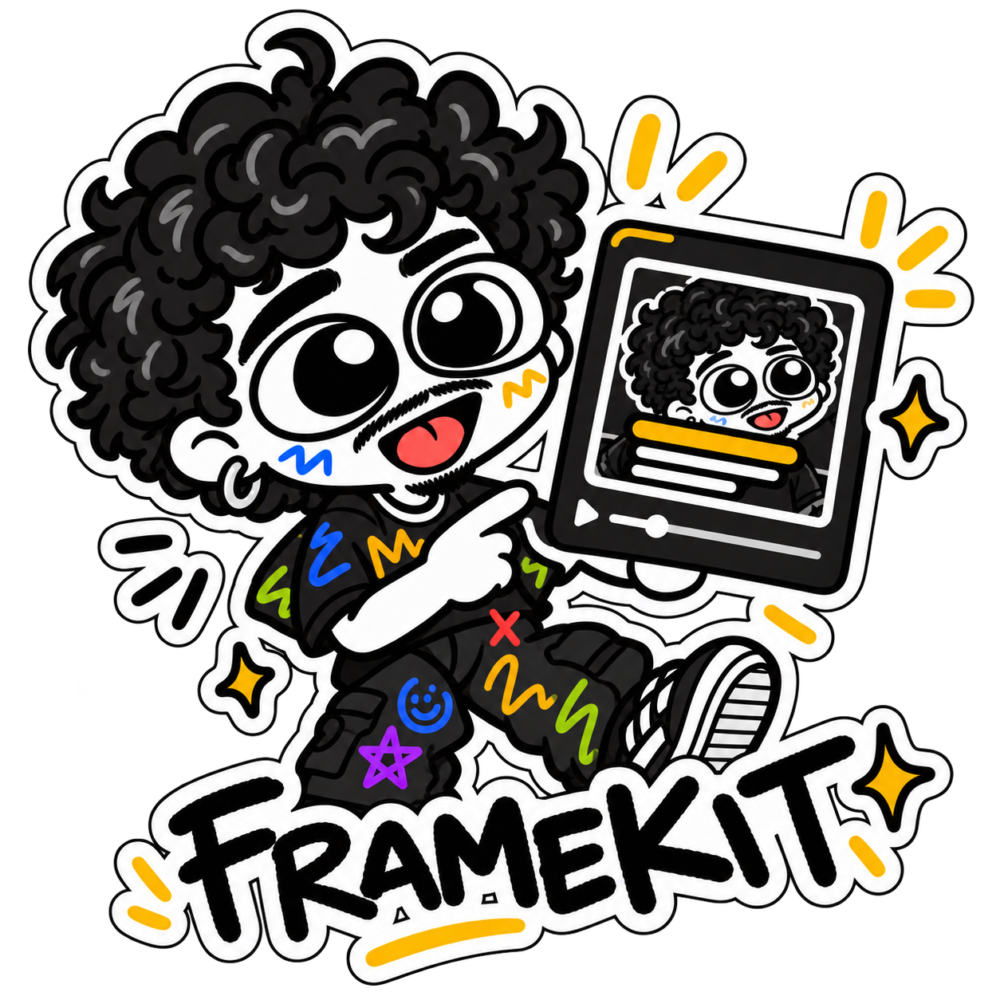

# framekit.


small tools for making things move.

a developer-friendly toolkit for creative media workflows.

<br clear="right">

<pre>
00. <a href="#current-status">status</a> ············ what works today
01. <a href="#getting-started">run it</a> ············ run the checks
02. <a href="#documentation">docs</a> ·············· the long version
03. <a href="#license">license</a> ··········· mit, and what is not
</pre>

#### what it is

framekit is for people who make small videos and would rather script the repetitive parts than
click through them. it starts with captions: rendering transparent caption frames you can lay
over a video. nothing in it decides how your video should feel; story, scenes, length, sound and
pacing stay yours.

#### what's inside

<pre>
00. <a href="captions/reference/">captions/reference</a> ··· frozen renderer
01. <a href="captions/presets/">captions/presets</a> ····· caption presets
02. <a href="captions/schemas/">captions/schemas</a> ····· json schemas
03. <a href="captions/examples/">captions/examples</a> ···· caption input samples
04. <a href="captions/tests/">captions/tests</a> ······· checks + fixtures
05. <a href="Sources/FrameKitCaptions/">Sources</a> ·············· swift package
06. <a href="docs/">docs</a> ················· the long version
07. <a href="assets/brand/">assets/brand</a> ········· the sticker
08. <a href=".github/workflows/">.github/workflows</a> ···· ci on macos
</pre>

#### current status

framekit is building its caption-rendering foundation. today the repository holds a frozen reference
renderer, the tests that guard it, the caption configuration (presets and caption input as versioned
json) and a swift rendering engine that draws frames from them. there is no command to run it yet.

what works:

- a frozen swift renderer that turns a frames file into one transparent png per frame
- a regression runner that re-renders nine reference frames and compares them with golden images, and
  tells you plainly when a different macos, swift or font version means it cannot vouch for them
- a versioned caption preset and caption input format, validated with stable error codes and
  published as json schemas
- the first preset, `kinetic-minimal`, with the reference look as exact values
- a swift library that renders a caption input with a preset into transparent png frames. for the look
  `kinetic-minimal` supports, they are byte for byte what the frozen renderer draws on the same machine
- unit and scenario tests, and ci on macos

what does not exist yet:

- a finished caption cli, or any `framekit` command
- a release

#### getting started

macos, the xcode command line tools (`swiftc`), python 3. no dependencies to install.

```sh
git clone https://github.com/RaioViajante/framekit.git
cd framekit
python3 -I -m unittest discover -s captions/tests
python3 -I captions/tests/run_reference_regression.py
swift test
```

on the machine the goldens came from you get `PASS`. elsewhere you may get `NOT VERIFIED`, which is
not a pass and says so. more in [getting started](docs/getting-started.md).

#### documentation

<pre>
start
00. <a href="docs/getting-started.md">getting started</a> ····· first run
01. <a href="docs/architecture.md">architecture</a> ········ how it fits

captions
02. <a href="docs/caption-configuration.md">caption presets</a> ····· presets, input
03. <a href="docs/caption-rendering.md">caption rendering</a> ··· renderer, design

quality
04. <a href="docs/regression-testing.md">regression testing</a> ·· policy, exit codes
05. <a href="docs/ci.md">ci</a> ·················· what ci can verify
06. <a href="docs/development.md">development</a> ········· tests, layout

legal
07. <a href="docs/licensing-and-provenance.md">licensing</a> ··········· mit, notice, art
</pre>

#### roadmap

current focus: kinetic caption rendering.

1. regression baseline, done ([#1](https://github.com/RaioViajante/framekit/pull/1))
2. [versioned caption presets](https://github.com/RaioViajante/framekit/milestone/1)
3. [a reusable swift renderer](https://github.com/RaioViajante/framekit/milestone/2)
4. [a caption cli](https://github.com/RaioViajante/framekit/milestone/3)
5. [quality checks](https://github.com/RaioViajante/framekit/milestone/4)
6. [a first usable release](https://github.com/RaioViajante/framekit/milestone/5)

each step is a milestone; its issues say what is in and what is out.

ideas, not promises, and nothing of them exists yet:

- transcription
- media inspection
- audio processing
- video composition
- asset utilities

#### license

<pre>
code + docs ·········· <a href="LICENSE">MIT</a>
test fixtures ········ <a href="NOTICE.md">limited permission</a>
sticker ·············· <a href="assets/brand/NOTICE.md">all rights reserved</a>
</pre>

code and documentation are mit. the golden images and the sticker are not: the fixtures may be used
to run this repository's own tests, the artwork is all rights reserved. see
[notice](NOTICE.md) and [licensing and provenance](docs/licensing-and-provenance.md).
